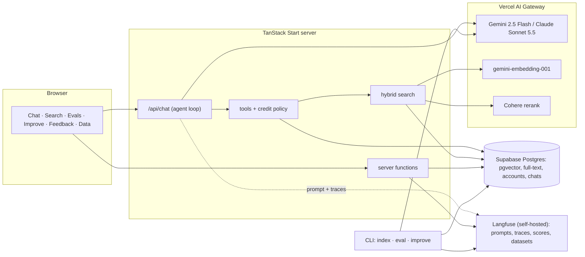
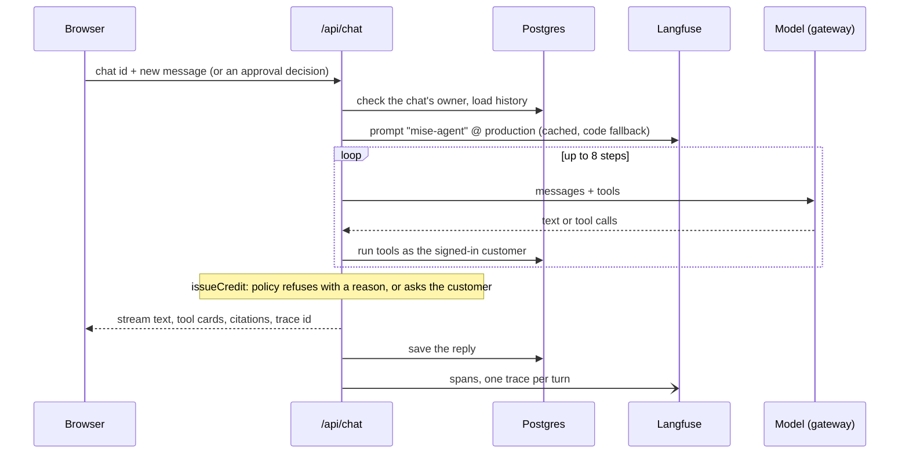
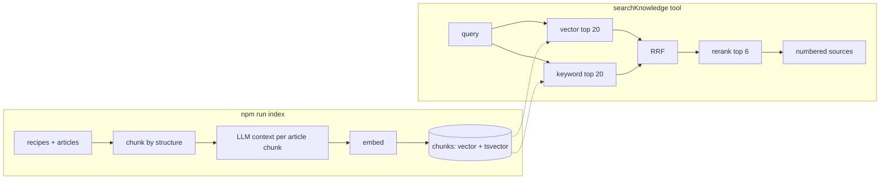
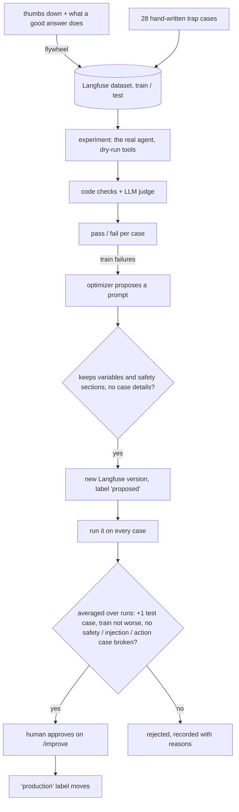

# Eval-Driven Agent

A small but complete LLM agent system, built end to end: retrieval-augmented generation, tools over a database, prompt management, tracing, evals, and a self-improving loop that only ships changes the evals can prove.

The agent works for **Mise**, a fictional meal-kit company. It answers questions about recipes, cooking and customer accounts, and can credit a missing ingredient once the customer approves. The data is fake, but it's full of planted traps (allergens, outdated policies, a prompt injection hidden in a recipe tip), and the evals check whether the agent falls for them.

Every model goes through the Vercel AI Gateway. The production prompt runs on Claude Sonnet 5.5, which also judges the evals and rewrites prompts; versions that don't pin a model run on Gemini 2.5 Flash (free tier). A prompt version can pin its own model, so the evals compare models as well as prompts.

## What it covers

| Concept | How it's done here | Where |
| --- | --- | --- |
| Embeddings and vector search | `gemini-embedding-001` at 1536 dimensions, pgvector HNSW with iterative scans so filters don't starve results | [`src/server/retrieval.ts`](src/server/retrieval.ts) |
| Keyword search | Postgres full-text search over a weighted `tsvector` (title > heading > body) | same |
| Hybrid search and reranking | Reciprocal Rank Fusion (k = 60), then a Cohere cross-encoder, with a timeout fallback to the fused order | [`src/lib/fusion.ts`](src/lib/fusion.ts) |
| Chunking and contextual retrieval | Structure-aware chunks; an LLM writes one sentence of context per article chunk | [`src/lib/chunking.ts`](src/lib/chunking.ts), [`scripts/index-content.ts`](scripts/index-content.ts) |
| RAG with citations | Numbered sources, unique across a chat, rendered as links | [`src/lib/sources.ts`](src/lib/sources.ts) |
| Agent loop | `ToolLoopAgent` runs the app's loop; a hand-written loop shows the same mechanics, with tests against a scripted fake model that prove the two match | [`src/server/agent/agent.ts`](src/server/agent/agent.ts), [`src/lib/agent-loop.ts`](src/lib/agent-loop.ts) |
| Tools over a database | Seven tools on Supabase Postgres via Drizzle; the customer id comes from the session, never from the model | [`src/server/agent/tools.ts`](src/server/agent/tools.ts) |
| Guardrails in code | Server-computed credit amounts, policy check before asking for approval, HMAC-signed approvals, retrieved text treated as data | [`src/server/agent/agent.ts`](src/server/agent/agent.ts), [`src/routes/api/chat.ts`](src/routes/api/chat.ts) |
| Prompt management | Versions and labels in Langfuse, each version pinning its model; promoting or rolling back means moving a label | [`src/server/agent/prompt.ts`](src/server/agent/prompt.ts) |
| Tracing | AI SDK OpenTelemetry spans to self-hosted Langfuse, one trace per chat turn | [`src/server/telemetry.ts`](src/server/telemetry.ts) |
| Feedback flywheel | Thumbs up/down become Langfuse scores; flagged answers become eval cases | [`src/server/feedback.server.ts`](src/server/feedback.server.ts) |
| Evals | 29 cases in train and test splits, code checks plus a Claude judge, versioned scorers, repeated runs, Langfuse experiments | [`src/evals/`](src/evals) |
| Self-improvement | An optimizer rewrites the prompt from train failures; a gate on held-out cases, averaged over runs, and a human approval decide | [`src/improve/`](src/improve) |

## Architecture



### One chat turn



### Retrieval



### Evals and self-improvement



## Results

The best version passes all 29 eval cases, and it got there through the model, not the prompt. The gate rejected all three prompt rewrites on Gemini Flash: none improved the held-out cases without losing something elsewhere. The latest prompt on Claude Sonnet passes every case, is the first version through the gate, and is now in production. Along the way, six judge bugs, a test bug and a context bug had to be fixed before the scores could be trusted.

The numbers, the gate decisions and what each round taught are in **[docs/results.md](docs/results.md)**.

## Running it

You need Node 24, Docker (or OrbStack) for Langfuse, a Supabase project (the free tier works), and a [Vercel AI Gateway](https://vercel.com/ai-gateway) key. The chat runs on the gateway's free tier (a card on file, no credits); the Claude judge and optimizer need a few dollars of credits. Without them, set `judge` and `optimizer` in `src/lib/models.ts` to `google/gemini-2.5-flash`.

```bash
npm install
cp .env.example .env.local   # add AI_GATEWAY_API_KEY and TOOL_APPROVAL_SECRET (openssl rand -base64 32)
```

**Langfuse** (traces, prompts, eval datasets) at http://localhost:3000:

```bash
npm run langfuse:env   # generates langfuse/.env and fills the Langfuse keys in .env.local
npm run langfuse:up
```

Then sign up at http://localhost:3000 with any email; new users join the `agent-lab` project.

**Database.** Run [`db/bootstrap.sql`](db/bootstrap.sql) once in the Supabase SQL editor. Then `npm run db:password` prints the SQL that sets `agent_app`'s password and the `DATABASE_URL` for `.env.local` (fill in your project ref and region from Supabase's connection settings, using the session pooler).

```bash
npm run db:migrate
npm run db:seed        # recipes, articles, customers, orders (data/*.json)
npm run index          # chunks and embeddings; reuses data/chunk-contexts.json
npm run prompt:seed    # every prompt version with its labels (prompts/)
npm run eval:seed      # the eval dataset (src/evals/cases.ts + evals/feedback-cases.json)
npm run dev            # http://localhost:3001
```

Pick a customer in the sidebar to try account questions ("What's in my next box?", "My salmon was missing, can I get a credit?").

## Scripts

| Command | What it does |
| --- | --- |
| `npm run dev` | The app on port 3001 |
| `npm test` · `npm run check` · `npm run typecheck` | Unit tests, Biome, TypeScript (also run in CI) |
| `npm run eval -- --label production` | Run the evals on a prompt label or `--version N`; `--split`, `--ids`, `--compare a,b`, `--model` to try another agent model |
| `npm run improve` | One self-improvement iteration; approve the result on `/improve` |
| `npm run improve -- --gate 1,2` | Gate two existing prompt versions |
| `npm run improve -- --promote 1` | Move the `production` label (rollback) |
| `npm run prompt:push -- --file prompts/vN.md --label candidate` | Upload a hand-written prompt version; `--model` pins its agent model |
| `npm run seed:export` | Save Langfuse's prompts and feedback cases to files |
| `npm run data:generate` | Regenerate the dummy data with Gemini and Faker |
| `npm run db:reset-activity` | Remove credits and tickets the agent created |

On the gateway's free tier (about 5 requests a minute per model), a full eval run takes about 20 minutes. With paid credits and `EVAL_RPM=60` it takes a few minutes; the Sonnet judge costs about a dollar a run.

## Layout

```
src/
  routes/          pages (chat, search, evals, improve, feedback, data) and /api/chat
  components/      chat UI, tool and approval cards, citations; ui/ and ai-elements/ are generated
  server/          server functions, retrieval, sessions, Langfuse
    agent/         prompt loading, tools, the agent (ToolLoopAgent)
  evals/           cases, the eval runner, scorers, experiments
  improve/         optimizer, validation, gate, the loop
  lib/             shared pure code: the hand-written agent loop, chunking, fusion, citations
  db/              Drizzle schema and client
scripts/           CLI: data, indexing, seeding, evals, improvement
data/              the dummy dataset and chunk contexts
prompts/           every prompt version, as files
evals/             eval reports and improvement records
docs/              a write-up per phase
langfuse/          docker compose for self-hosted Langfuse
```

## How it was built

In phases, each ending with something runnable and a write-up:

0. [Setup](docs/00-setup.md): chat UI, gateway, tracing, database roles
1. [Data](docs/01-data.md): the dummy dataset and its traps, saved chats
2. [Retrieval](docs/02-retrieval.md): chunking, contextual retrieval, hybrid search, reranking
3. [Agent](docs/03-agent.md): prompt management, tools, citations, approvals
4. [Feedback](docs/04-feedback.md): scores and the data flywheel
5. [Evals](docs/05-evals.md): cases, scorers, experiments, results
6. [Self-improvement](docs/06-self-improvement.md): optimizer, gate, promotion
7. [Agent loop](docs/07-agent-loop.md): ToolLoopAgent and a hand-written loop, compared

Then [the results](docs/results.md): what the evals measured, version by version.

## Limitations

- **An uncalibrated judge.** Sonnet judges Gemini's answers, but nobody has yet measured how often it agrees with a human grader.
- **A small test split.** 13 held-out cases; the gate averages repeated runs, but more cases would make its decisions sharper.
- **One candidate per iteration.** Frameworks like DSPy and GEPA search over many candidates; this loop shows the mechanics with one.
- **Simulated sign-in.** The customer picker stands in for real authentication.
