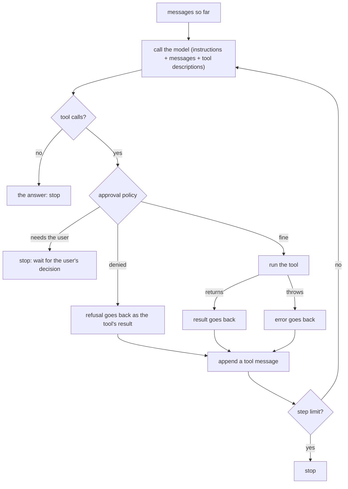
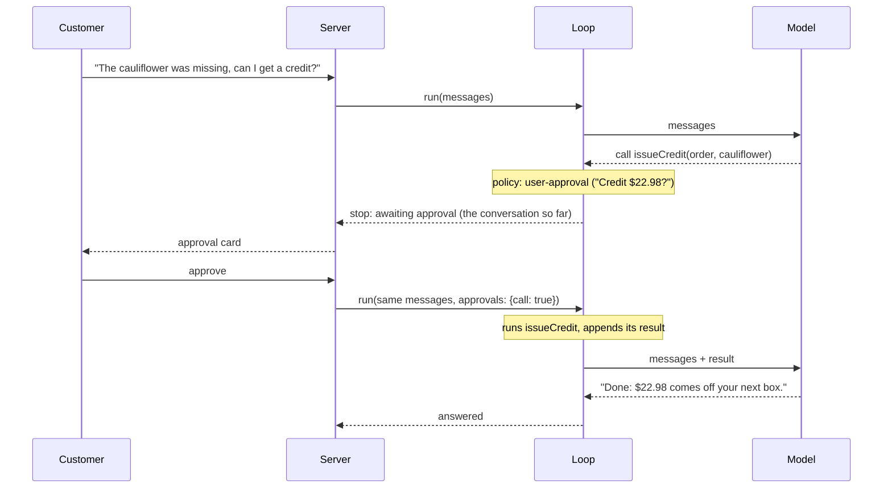

# Phase 7: The agent loop

An "agent" is a model in a loop: it decides which tool to call, sees the result, and decides again, until it can answer. The app runs that loop with the AI SDK's `ToolLoopAgent`. This phase adds a hand-written version of the same loop, so you can see every step, and tests that prove the two behave the same.

| | Where | Used by |
| --- | --- | --- |
| `ToolLoopAgent` | `src/server/agent/agent.ts` (`createAgent`) | the chat (`agent.stream()`) and the evals (`agent.generate()`) |
| Hand-written loop | `src/lib/agent-loop.ts` (`runAgentLoop`) | study, and the tests |
| Tests with a scripted fake model | `src/lib/agent-loop.test.ts` | `npm test` |

## The loop



`runAgentLoop` is about 250 lines with its comments and helpers, and the core is this:

```ts
for (let step = 0; step < maxSteps; step++) {
  const response = await generateText({
    model, system: instructions, messages,
    tools: declarationsOf(tools), // no execute: the SDK only parses the calls
  });
  messages.push(...response.response.messages);
  if (response.toolCalls.length === 0) return done("answered");

  for (const call of response.toolCalls) {
    // approval policy → denied / needs the user / run it
  }
  messages.push({ role: "tool", content: results });
  if (pending.length > 0) return done("awaiting-approval", pending);
}
return done("max-steps");
```

A few things are easy to get wrong:

- **One model call per step.** The tools go to `generateText` without their `execute` function, so the SDK only makes the model call and validates the inputs against each tool's schema. Running the tools is the loop's job. (Lower than this is the provider's wire format, which isn't what an agent loop is about.)
- **Errors are results.** A tool that throws doesn't end the turn: its error becomes the tool's result (`error-text`), and the model can retry with other input or explain the problem. Invalid input works the same way.
- **The conversation is the state.** Every step appends the model's message and a tool message with one result per call. The model sees the whole history on every call; nothing else carries over between steps.
- **A step limit.** A model can keep calling tools forever. The app stops after 8 model calls.

## Approvals are interrupts

`issueCredit` needs the customer's OK. A server can't wait for a click inside a request, so the loop **stops** with the pending call, and a later call resumes it with the decision:



The approval policy runs before anyone is asked. It can refuse outright (wrong customer, over the cap, too old), and then the refusal goes back to the model as the tool's result (`execution-denied`, with the reason) so it can explain. Both loops take the same policy function, `creditApproval` in `agent.ts`.

In the app, the stopped turn is an assistant message with an `approval-requested` tool part. The browser shows the card, and sends the decision back; the server takes only the decision from the client and the rest from its stored copy (phase 3), and the SDK verifies the approval's HMAC signature.

## What ToolLoopAgent adds

The loop is the same. Everything around it is what the library is for:

| | Hand-written loop | ToolLoopAgent |
| --- | --- | --- |
| The loop: model call, tools, results, repeat | yes | yes |
| Errors and refusals fed back to the model | yes | yes |
| Approvals as interrupts, resumable | yes | yes, plus HMAC-signed approval requests |
| Stop conditions | a step limit | composable: `stepCountIs`, `hasToolCall`, your own |
| Streaming | no: each step returns whole | text and tool-call deltas as they're generated, and a UI stream for `useChat` |
| Tool calls in one step | one after another | concurrent (`toolCallConcurrency`) |
| Retries | none | backoff on rate limits and transient errors (`maxRetries`) |
| Per-step changes | no | `prepareStep`: another model, fewer tools or trimmed messages for a step |
| Broken tool calls | reported to the model | `repairToolCall` can fix them first |
| Tracing | none | an OpenTelemetry span per step and per tool, which is what Langfuse shows |
| Structured output | no | `output` |
| Callbacks | no | `onStepEnd`, `onToolExecutionStart` and the rest |

So the library isn't magic. It's the loop above, plus streaming, concurrency, retries, tracing and the hooks a real app needs.

## Testing an agent without a model

The tests use the AI SDK's `MockLanguageModelV4`, which replays a script: each model call returns the next scripted response, such as "call `getOrder` with `o1`" and then "Your order was delivered." No network and no API key, so the tests are fast and deterministic, and they check the loop's behavior, not the model's:

- an answer without tools stops after one call;
- a tool's result reaches the next model call;
- a tool's error reaches the model instead of crashing the loop;
- the loop stops at the step limit;
- a refused call goes back with the policy's reason;
- a call that needs the user stops the loop, and approving resumes it.

Two **parity tests** run the same script through `ToolLoopAgent` and `runAgentLoop` and check that the model was sent the same conversation at every step. The first version failed one: the SDK sends a tool's error as `Error: No such order.` and the hand-written loop sent `No such order.` A small difference, but exactly what a parity test is for.

What a scripted model can't tell you is whether the real model makes good decisions. That's what the evals (phase 5) are for.

## Questions this answers

- **What is an agent loop?** Call the model; if it asks for tools, run them and append the results; call it again; stop when it answers or after a step limit. Everything else is built around that.
- **Why feed errors back instead of throwing?** The model can recover: retry with other input, try another tool, or explain. Crashing the turn throws that away.
- **How does human-in-the-loop approval work on a stateless server?** The loop stops and returns the pending call with the conversation so far. The decision arrives in a later request, and the loop resumes from the same messages.
- **Why a step limit?** A model can loop on tool calls; the limit bounds cost and latency.
- **How do you test an agent deterministically?** Replace the model with a scripted fake and test the loop's behavior; test the model's judgment separately with evals.
- **When would you write your own loop?** When the framework's loop gets in the way: a custom scheduler, durable execution across processes, unusual stopping or branching. LangGraph, for example, models the loop as an explicit state graph with checkpoints, which is the same idea with persistence built in.
